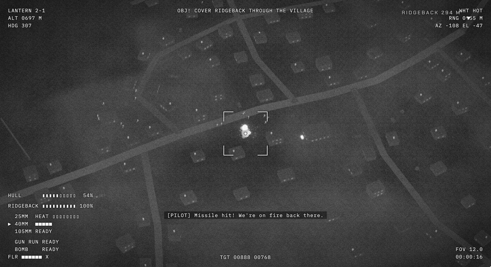
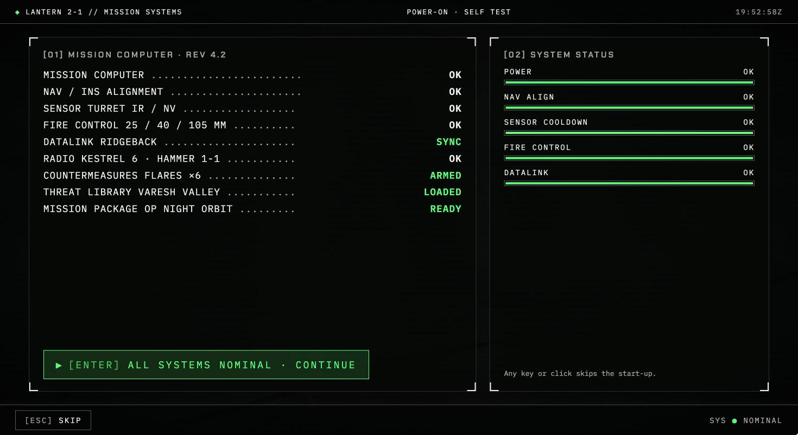
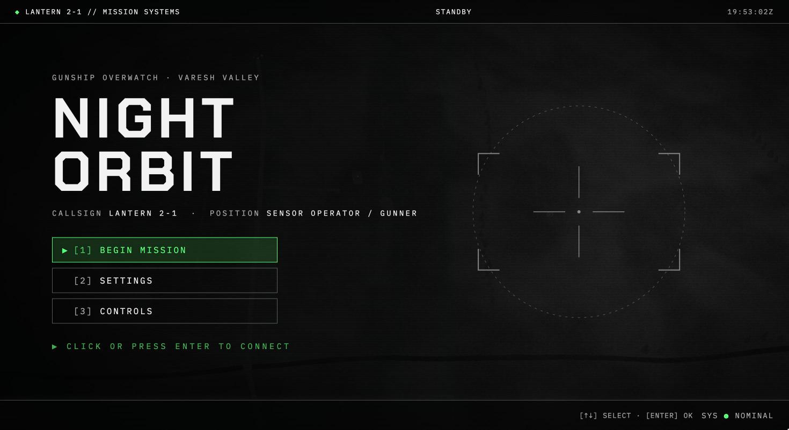
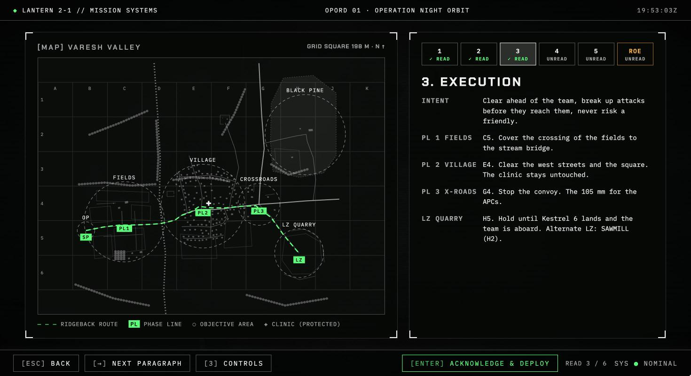
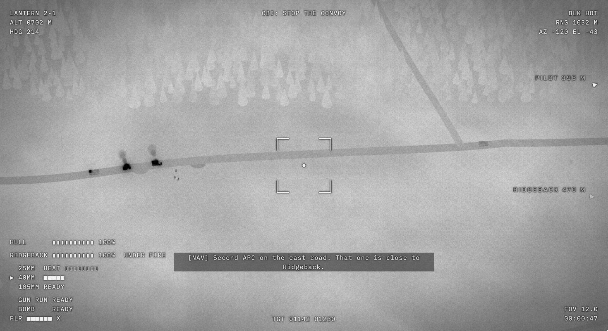
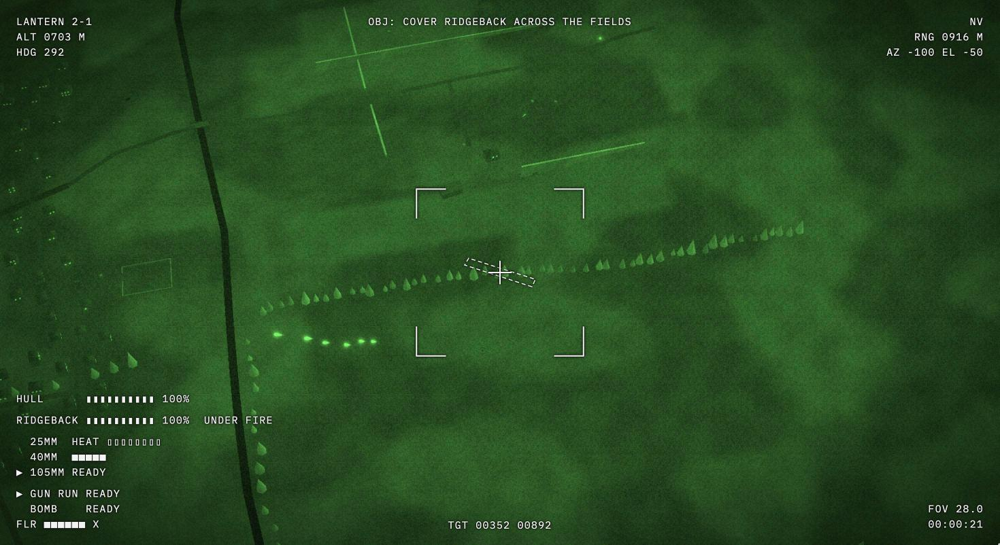
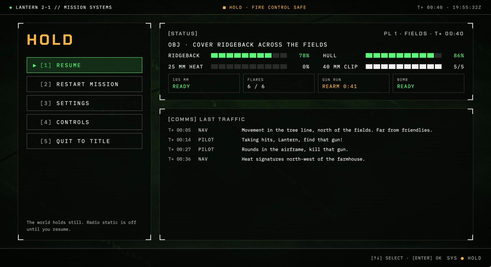
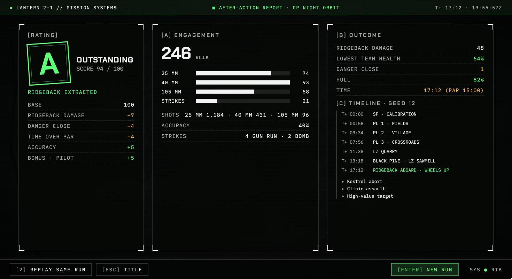

# NIGHT ORBIT

**Gunship overwatch in the browser.** You are the sensor operator and gunner of **LANTERN 2-1**, a
gunship circling a night-time valley. Through a grainy thermal feed you cover a four-person recon
team on foot, picking the right gun, leading every shot, and never forgetting that the people you
protect are often standing right next to the people you shoot at.

[](https://github.com/aliemrepmk/night-orbit/actions/workflows/ci.yml)
&nbsp; **[▶ Play in your browser](https://aliemrepmk.github.io/night-orbit/)** &nbsp;·&nbsp; desktop,
mouse and keyboard, headphones recommended



Built with **TypeScript**, **three.js** and **Vite**. Everything you see and hear is generated in
code: no models, textures or audio files are loaded.

---

## Contents

- [The game](#the-game)
- [Screenshots](#screenshots)
- [How to play](#how-to-play)
- [Controls](#controls)
- [Settings and performance](#settings-and-performance)
- [Running it locally](#running-it-locally)
- [How it is built](#how-it-is-built)
- [Testing and balance](#testing-and-balance)
- [Deployment](#deployment)
- [Project documents](#project-documents)
- [Credits](#credits)

---

## The game

Recon team **RIDGEBACK** has lost its observation post in the **Varesh Valley**. Militia are moving
up from the villages. Ridgeback must cross the valley on foot, over the fields and the stream
bridge, through the village, past the crossroads, to the landing zone, where **KESTREL 6** will
lift them out. You keep them alive until it does.

- **One handcrafted mission, about 15–18 minutes**, in five phases: calibration, the fields, the
  village, the convoy at the crossroads, and the extraction.
- **A different run every time.** Each run rolls an extraction twist and two to four side events
  (a delayed helicopter, an overrun LZ, an aborted pick-up and a new LZ in the forest, mortar teams,
  a downed pilot to protect, a fleeing militia commander, a civilian bus, a wounded operator, fog,
  a jammed gun, a missile-team ambush).
- **Restraint is the challenge.** Hitting Ridgeback, the protected field clinic, the civilian bus or
  the extraction helicopter ends the mission. Big guns become dangerous the closer the enemy gets.
- **Enemy air defense.** Triple-A guns and trucks damage your hull and can abort your air strikes;
  missile teams fire at you, and only well-timed flares save you.
- **A real thermal sensor.** White-hot, black-hot and night vision, with grain, bloom, refocus blur,
  scanlines and a weapon-switch static burst. Bodies cool after death, wrecks burn, craters stay warm.
- **Radio drama.** A fire-control officer, a navigator, the pilot, Ridgeback, Kestrel 6 and the
  strike pilot talk you through the fight, with squelch, static and subtitles.
- **Mission-systems screens.** The menus are the gunship's own computer: a power-on self test, a
  five-paragraph operation order on a gridded map, a HOLD status card when you pause, and an
  after-action report with a grade when you finish.

> NIGHT ORBIT is an original game inspired by the gunship-overwatch genre. Its setting, characters,
> dialogue, map and art are its own.

---

## Screenshots

|                                                                                                                             |                                                                                                                   |
| :-------------------------------------------------------------------------------------------------------------------------: | :---------------------------------------------------------------------------------------------------------------: |
|                                                |                                                                        |
|                                             **Power-on self test** (skippable)                                              |                                                     **Title**                                                     |
|                          |  |
|                            **Briefing**: the order, the route and phase lines on a lettered grid                            |                        **Black-hot**: the convoy stopped by the 105 mm, crews bailing out                         |
|  |                         |
|                           **Night vision**: aiming a gun run (the dashed strip) under enemy fire                            |                                 **HOLD**: status card and the last radio traffic                                  |
|      |                                                                                                                   |
|                                                   **After-action report**                                                   |                                                                                                                   |

---

## How to play

1. **Find Ridgeback.** They wear IR strobes that blink in every sensor. Calibration walks you
   through the sensor and the guns first.
2. **Clear ahead of the team** as they walk, and break up attacks before they reach them. Ridgeback
   fights back, and slowly recovers when nobody is shooting at them.
3. **Pick the right gun.** Shells take time to fly. Lead moving targets, and mind the blast radius.

### Weapons

| Gun        | Fire                               | Blast | Danger close | Use it for                                  |
| ---------- | ---------------------------------- | ----- | ------------ | ------------------------------------------- |
| **25 mm**  | Hold to fire; overheats after ~4 s | 2.5 m | 4 m          | Precise work next to friendlies, the clinic |
| **40 mm**  | One shot per click, 5-round clips  | 8 m   | 12 m         | Small groups, technicals                    |
| **105 mm** | One round, 5 s reload              | 22 m  | 33 m         | Groups, trucks, APCs, triple-A              |

Each gun has its own zoom: the 25 mm looks closest, the 105 mm widest.

### Air support (HAMMER 1-1)

| Strike      | Arrives after | Rearm | Danger close | What it does                                        |
| ----------- | ------------- | ----- | ------------ | --------------------------------------------------- |
| **Gun run** | 7 s           | 60 s  | 25 m         | A 60 m strip of cannon fire; turn it with the wheel |
| **Bomb**    | 18 s          | 90 s  | 100 m        | One enormous blast; kills anything                  |

Press `T` to aim a strike (a footprint preview follows the crosshair), click to call it. Too much
triple-A near the target and the pilot aborts.

### Staying alive

- **Hull:** triple-A and missiles damage the gunship. Kill air defense early.
- **Flares (×6):** press `X` when the missile warning beeps. Too late and the missile still hits.

### Rating

Finishing gives a grade from **S** to **D**: points come off for damage to Ridgeback, danger-close
shots and time over par (15:00), and go back on for accuracy and bonus objectives. The after-action
report shows the whole breakdown.

---

## Controls

| Key         | Action                                                      |
| ----------- | ----------------------------------------------------------- |
| Mouse       | Slew the sensor (aim)                                       |
| Left click  | Fire (hold for the 25 mm)                                   |
| `1` `2` `3` | 25 mm · 40 mm · 105 mm                                      |
| `Q` / wheel | Cycle weapon                                                |
| `F`         | Sensor: white-hot → black-hot → night vision                |
| `T`         | Air support: gun run → bomb → off (wheel turns the gun run) |
| `X`         | Flares                                                      |
| `H`         | Controls overlay                                            |
| `Esc`       | HOLD (pause)                                                |
| `F1`        | Performance stats (FPS, CPU and GPU ms, draw calls)         |

Every menu works from the keyboard as well: number keys press the soft keys, `Enter` the
highlighted one, `Esc` goes back, arrows move between options. If the browser refuses pointer lock,
hold the **right** mouse button and drag to aim.

---

## Settings and performance

**SETTINGS** has three pages: **CONTROLS** (mouse sensitivity, invert Y), **AUDIO** (master, effects,
radio and engine volumes) and **DISPLAY** (render resolution, screen shake, subtitles). Settings
are saved in the browser.

The game targets 60 FPS on a mid-range laptop. On a MacBook the busiest moments (56 enemies, all
three guns firing) take about 2 ms of CPU and 9 ms of GPU per frame. On a slower GPU, set
**RENDER RESOLUTION** to 75 % or 50 % (GPU time drops to about 5 ms and 3 ms here).

---

## Running it locally

Requires **Node.js 22**.

```bash
git clone https://github.com/aliemrepmk/night-orbit.git
cd night-orbit
npm ci
npm run dev          # http://localhost:5173
```

| Command              | What it does                                                     |
| -------------------- | ---------------------------------------------------------------- |
| `npm run dev`        | Dev server with hot reload                                       |
| `npm run check`      | Typecheck + lint + all tests (must be green before every commit) |
| `npm run build`      | Production build into `dist/`                                    |
| `npm run preview`    | Serve the production build                                       |
| `npm run test:watch` | Re-run tests on every save                                       |
| `npm run balance`    | Balance report: a bot plays the whole mission over many seeds    |
| `npm run format`     | Prettier on the whole repo                                       |

**Debugging.** Add `?debug=1` to the URL for the stats overlay and cheats (`G` god mode, `N` next
phase, `K` kill all, `[` / `]` time scale, `F2` map overlay, `F3` zone tour). With `?debug=1` (or in
a dev build) the URL also takes `phase=village` (start at a phase), `seed=1234` (repeat a run) and
`twist=mortar,kestrelAbort` (force events), e.g. `?debug=1&phase=vehicles&seed=7`.

---

## How it is built

```
src/
  core/      game loop (fixed 60 Hz steps), input, event bus, seeded RNG
  gunship/   orbit, sensor camera, weapons, ballistics, shells, air support
  combat/    damage and armor, explosions, enemy air defense
  units/     soldiers, squads, vehicles, helicopter, AI, spawning
  world/     the handcrafted map (data), terrain, roads, forest, collision
  mission/   the mission script, twists, radio, stats, headless game, balance bot
  render/    renderer, thermal / night-vision shaders, sensor effects, GPU timer
  fx/        heat, particles, craters, fire, tracers
  audio/     synthesized sounds and the mixer
  ui/        HUD and the mission-systems screens
```

- **Rendering.** Every object writes a heat value (or, in night vision, reflected light) into a
  half-float render target, followed by bloom and a single thermal pass: contrast curve, polarity,
  grain, scanlines, vignette and blur. Soldiers and trees are instanced, so a full battle draws in
  about 60 draw calls.
- **Simulation.** A fixed 60 Hz step drives the orbit, the sensor, the weapons, shells in flight,
  the AI (cover, line of sight, morale, fleeing), vehicles and the mission script. Hits are ray and
  radius checks against the terrain and building boxes; there is no physics engine.
- **The mission is data.** Phases are lists of steps (a condition, then actions) in
  `src/mission/missionDef.ts`, with safety timeouts so a run can never soft-lock. The map is data
  too, in `src/world/MapData.ts`.
- **Audio** is synthesized with the Web Audio API: four detuned engine drones, gun reports, impacts,
  radio squelch and static, all routed through effects, radio and ambience buses.
- **All tuning numbers** live in `src/config.ts` and the weapon and strike tables, not in the systems.

---

## Testing and balance

- **About 690 automated tests** (Vitest) cover the logic, which lives in pure, DOM-free modules:
  sensor math, ballistics, damage falloff, AI decisions, the mission runner, the radio queue, the
  rating, and the screens' text. Every bug fix comes with a regression test.
- **An auto-play test** plays the whole mission headless, through every twist, to MISSION COMPLETE.
- **A balance bot** (`npm run balance`) flies the real gunship with human limits (reaction time,
  aim error, slew speed, target lead, flares, strikes) at three skill levels over many seeds, and
  reports mission length, team damage, hull damage and failures. Over 30 seeds, a sharp player
  always wins with an A; an average one wins 29 of 30 with a B.

---

## Deployment

Every push to `main` runs the [CI workflow](.github/workflows/ci.yml): `npm ci`, typecheck, lint,
tests and a production build. If all of it passes, the build is published to **GitHub Pages**.
Pull requests are checked but never deployed. The build uses relative asset paths, so it runs from
any URL path.

---

## Project documents

- [`PLAN.md`](PLAN.md): the full design (setting, systems, the mission beat by beat, balance tables)
  and the milestones M0–M10.
- [`STATUS.md`](STATUS.md): where the project stands, what was tested and decided, and what comes next.

---

## Credits

- [three.js](https://threejs.org/) (MIT) for WebGL rendering, and
  [simplex-noise](https://github.com/jwagner/simplex-noise.js) (MIT) for the terrain.
- Fonts: [Chakra Petch](https://github.com/m4rc1e/Chakra-Petch) and
  [IBM Plex Mono](https://github.com/IBM/plex), both under the SIL Open Font License 1.1, bundled
  via [Fontsource](https://fontsource.org/). Their licence texts ship with the build in
  `public/licenses/`.

The game's own code has no licence file yet: until one is added, all rights are reserved by the author.
